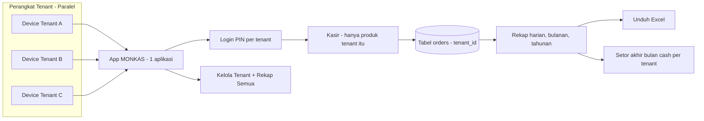
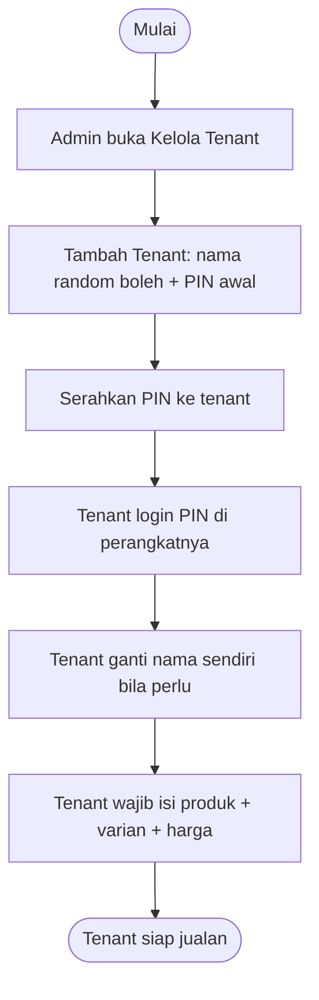
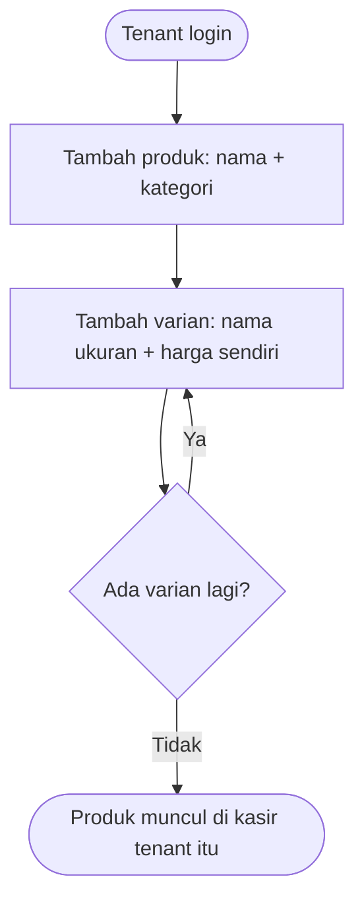

# MONKAS (Monjali Kasir) — Blueprint, Case, dan Flowchart

> Dokumen Notion-ready. Status: full planning, eksekusi DITAHAN. App kasir STANDALONE, tidak ada hubungan dengan kerja.inc.

## 1. Ringkasan

Satu lokasi besar menampung banyak tenant (contoh Cafe A, Cafe B, Cafe C). Setiap tenant jualan dari perangkat atau layar masing-masing secara paralel (buka bersamaan, bukan bergantian). Satu kode Quick Response Indonesian Standard (QRIS) bersama untuk semua tenant. Uang masuk ditampung dahulu (parkir) di database atau sistem pada satu rekening manager, lalu akhir bulan diserahkan tunai (cash) ke tiap tenant sesuai catatan database. Satu struk hanya untuk satu tenant.

## 2. Peran

| Peran | Kewenangan | Batasan |
|---|---|---|
| Admin atau manager | Tambah tenant + Personal Identification Number (PIN) awal, nonaktifkan tenant, lihat rekap semua tenant, setor akhir bulan | Tidak bisa nonaktifkan tenant yang ada order hari itu; tidak hapus permanen |
| Tenant (kasir = tenant itu sendiri) | Login PIN, ganti nama sendiri, kelola produk dan varian sendiri, kasir, void pakai PIN sendiri, rekap sendiri, tutup hari, unduh Excel | Hanya lihat data tenant sendiri; tidak lihat data tenant lain |

## 3. Blueprint Sistem



Tabel database: tenants (id, nama, PIN, aktif), products (id, tenant_id, nama, kategori, aktif), variants (id, product_id, nama, harga), orders (id, tenant_id, items JSON + harga-history, total, status, waktu, tutup_hari).

## 4. Flowchart Alur Utama

### 4.1 Pendaftaran tenant (admin daftarkan)



### 4.2 Daftar produk

Field produk: nama, kategori (Minuman atau Makanan, untuk filter kasir), varian sebagai satu baris + satu harga sendiri (contoh Kopi Susu Normal 10 ribu, Kopi Susu Besar 13 ribu; satu ukuran = satu baris). Deskripsi dihapus, diganti note per baris pesanan di kasir (contoh less sugar), ikut struk dan rekap.



### 4.3 Kasir sampai lunas (langsung bayar, tanpa open table)

```mermaid
flowchart TD
  S([Kasir login PIN]) --> A[Pilih tenant otomatis dari PIN]
  A --> B[Grid menu + search + filter kategori]
  B --> C[Klik produk: popup semua varian + tambah-kurangi]
  C --> D[Masuk keranjang kanan - edit jumlah + note per baris]
  D --> E[Tekan Bayar]
  E --> F[Pelanggan scan QRIS printed bersama]
  F --> G[Kasir tekan Lunas]
  G --> H[Tercatat: tenant, barang, varian, porsi, total, waktu]
80:   H --> I{Print nota?}
81:   I -->|Ya, pelanggan mau| J[Cetak nota thermal 58/80mm]
82:   I -->|Tidak, pelanggan tolak| K([Selesai tanpa print])
```

Keputusan: sistem open table atau pending DIHAPUS total. Semua langsung bayar. Tidak ada split bill. Tidak ada ganti tenant cepat tanpa PIN.

### 4.4 Void dan edit

Edit item per baris: ubah varian, jumlah, atau hapus sebelum Lunas. Void wajib pakai PIN tenant sendiri. Status menunggu konfirmasi: order lunas tapi menunggu dibuat atau diantar, lalu selesai.

### 4.5 Tutup hari

Tombol Tutup Hari di header atas kanan, urutan: Keluar, Tutup Hari, nama tenant. Popup tengah: judul Tutup Hari + nama tenant + tanggal, rincian per varian (nama + ukuran + jumlah + rupiah) + total uang masuk angka besar, tombol Kembali atau Konfirmasi. Setelah konfirmasi: popup pilihan print rekap (Ya print 1 lembar / Tidak), muncul layar sukses + tombol Unduh Excel, kasir terkunci, tombol Buka Hari Baru untuk jualan lagi. Nota per transaksi dan rekap tutup hari SIFATNYA OPSIONAL — default ditawarkan print, pelanggan boleh tolak.

### 4.6 Ketahanan data

Data Lunas aman di database walau web atau aplikasi di-close. Keranjang belum bayar auto-save localStorage di perangkat.

## 5. Tabel Spesifik

### 5.1 Tabel tenants

| Kolom | Tipe | Aturan |
|---|---|---|
| id | uuid | primary key |
| nama | text | boleh random saat dibuat admin, tenant bisa ganti sendiri setelah login |
| pin | text hash | 4-6 digit, unik per tenant, wajib ganti bila bocor |
| aktif | boolean | false = nonaktif (soft-delete), data lama tetap ada |
| dibuat | timestamp | kapan tenant dibuat |

### 5.2 Tabel products + variants

| Kolom | Tipe | Aturan |
|---|---|---|
| id | uuid | primary key |
| tenant_id | uuid | milik tenant mana, kasir hanya tampil ini |
| nama | text | contoh Kopi Susu |
| kategori | text | Minuman atau Makanan, untuk filter kasir |
| varian | text | contoh Normal, Besar, Kecil |
| harga | integer | rupiah penuh, contoh 10000, beda varian beda harga |
| aktif | boolean | false = disembunyikan dari kasir, riwayat aman |

Aturan unik: kombinasi (tenant_id + nama + varian) tidak boleh kembar. Nama sama lintas tenant BOLEH. Harga yang tercatat di order adalah salinan saat transaksi (harga history), jadi ganti harga tidak merusak struk lama.

### 5.3 Tabel orders (satu baris = satu struk, satu tenant)

| Kolom | Tipe | Aturan |
|---|---|---|
| id | uuid | nomor struk |
| tenant_id | uuid | struk milik tenant ini saja |
| items | json | daftar baris: nama, varian, jumlah, harga-saat-itu, note per baris |
| total | integer | jumlah semua baris, rupiah |
| status | text | lunas, atau menunggu-konfirmasi, atau selesai |
| waktu | timestamp | kapan Lunas ditekan |
| tutup_hari | date | masuk rekap tanggal berapa |

### 5.4 Layout layar kasir (tablet landscape)

| Area | Isi | Spesifik |
|---|---|---|
| Header kiri | Nama tenant + tanggal hari ini | Selalu terlihat |
| Header kanan | Keluar, Tutup Hari, nama tenant | Tutup Hari jarang ditekan tapi terlihat, ada popup konfirmasi |
| Kiri atas | Search + filter Minuman / Makanan / Semua | Filter kategori kasir |
| Kiri bawah | Grid kartu produk, satu kartu = satu varian + harga | Klik kartu buka popup bila produk bervarian |
| Popup varian | Semua ukuran sekaligus, tiap baris ada tombol kurang (-) dan tambah (+) | Contoh Normal 10rb [-] 0 [+], Besar 13rb [-] 0 [+], tombol Masuk Keranjang |
| Kanan | Keranjang: daftar baris + jumlah + note + total besar + tombol Bayar | Edit jumlah dan note per baris sebelum Bayar |
| Bayar | Pelanggan scan QRIS printed bersama, kasir tekan Lunas | Tercatat tenant, barang, varian, porsi, total, waktu |

### 5.5 Isi file Excel unduhan

| Kolom Excel | Sumber |
|---|---|
| Tanggal | tutup_hari |
| Nomor struk | orders.id |
| Tenant | tenants.nama |
| Barang | items nama |
| Varian atau ukuran | items varian |
| Jumlah | items jumlah |
| Harga satuan | items harga-saat-itu |
| Subtotal baris | jumlah x harga satuan |
| Total struk | orders.total |
| Waktu lunas | orders.waktu |
| Catatan | items note |

### 5.6 Aturan PIN dan keamanan

| Aturan | Spesifik |
|---|---|
| Login | Pilih tenant + masukkan PIN, salah ditolak coba lagi |
| Isolasi | PIN tenant A hanya buka data A, tidak bisa intip B |
| Void | Wajib PIN tenant sendiri, tanpa PIN ditolak |
| Admin | PIN sendiri, bisa masuk Kelola Tenant + rekap semua, tidak bisa nonaktifkan tenant yang ada order hari itu |
| Ganti tenant cepat tanpa PIN | TIDAK ADA, selalu login ulang |

## 6. Case atau Skenario

| Nomor | Case | Alur sukses | Alur gagal |
|---|---|---|---|
| C1 | Tenant baru | Admin tambah + PIN, tenant isi produk, siap jualan | Tenant belum isi produk: kasir kosong, tampil panduan isi produk |
| C2 | Jual 1 varian | Klik, jumlah, Bayar, Lunas, tercatat | Pelanggan batal scan: order tidak dilunaskan, tidak tercatat |
| C3 | Jual 2 ukuran sekaligus | Popup Kopi Susu: Normal 1 + Besar 1, masuk keranjang 2 baris, Bayar, Lunas | Salah jumlah: edit per baris sebelum Lunas |
| C4 | Salah input | Edit atau hapus baris sebelum Lunas | Sudah Lunas: harus void pakai PIN sendiri |
| C5 | PIN salah | Ditolak, coba lagi | PIN tenant A di device B: hanya lihat data A |
| C6 | Harga berubah | Harga baru untuk order baru; struk lama tetap (harga history) | — |
| C7 | Nonaktifkan tenant | Berhasil bila tidak ada order hari itu | Ada order hari itu: ditolak (dikunci) |
| C8 | Tutup hari | Popup rincian benar, konfirmasi, kunci, unduh Excel | Web di-close sebelum tutup: data Lunas aman, lanjutkan lagi |
| C9 | Nama produk sama lintas tenant | Boleh, unik = tenant_id + nama + varian | Nama sama dalam tenant sama: ditolak dengan pesan jelas |
| C10 | Setor akhir bulan | Rekap per tenant dibuka semua, serahkan cash sesuai angka | Angka sengketa: rinci per transaksi + harga history jadi bukti |

## 6. Rekap dan Excel

Rekap berjenjang otomatis: harian, bulanan, tahunan. Isi: total penjualan, jumlah minuman, daftar transaksi, total sebelum tutup kasir, filter kategori. Tombol unduh Excel berisi transaksi hari itu per tenant. Rekap admin: per tenant + total semua, dibuka semua rinci per transaksi, untuk setor akhir bulan.

## 7. Yang Sengaja Tidak Ada

Integrasi QRIS gateway atau QR dinamis; self-order atau QR meja atau nomor meja; stok wajib; struk gabungan multi-tenant; daftar tenant mandiri; hapus permanen; ganti tenant cepat tanpa PIN; split bill; open table atau pending. Print nota TERSEDIA tapi opsional per transaksi (Ya print / Tidak).

## 8. Plan Eksekusi (6 Task, DITAHAN)

Task 1: Setup repo Next.js PWA baru + schema Supabase project BARU. Task 2: Login PIN + Kelola Tenant. Task 3: Kelola Produk + varian harga. Task 4: Kasir klik + edit baris + lunas. Task 5: Status konfirmasi + void PIN. Task 6: Rekap + tutup hari + unduh Excel. Detail penuh: docs/MONKAS.md.
